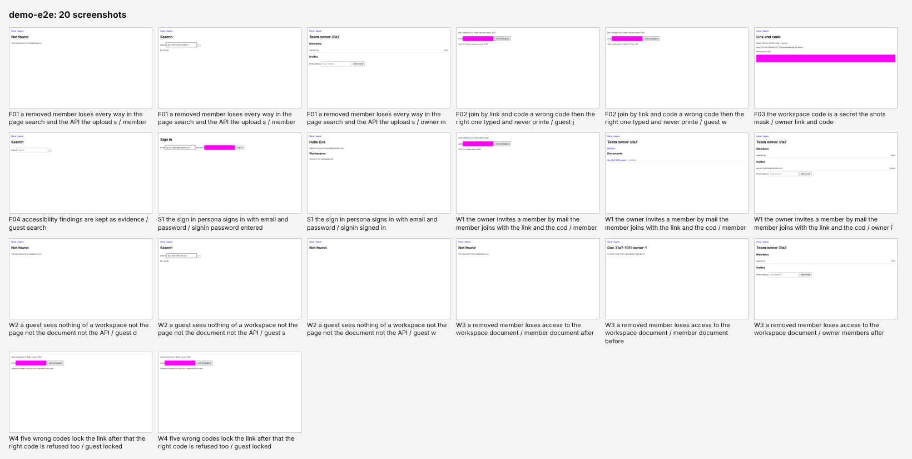
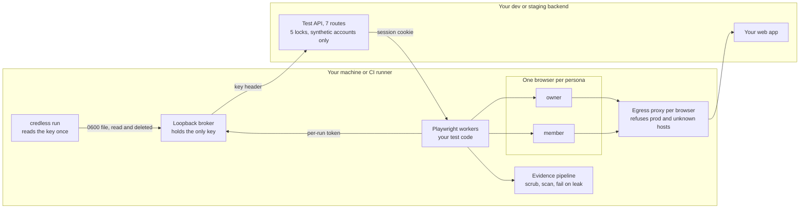

# credless

**Signed-in, multi-user Playwright end-to-end tests that AI coding agents can run without your credentials.**

credless is an open-source Playwright toolkit for testing logged-in, multi-user web apps on dev or staging. It lets
AI coding agents (Claude Code, Cursor, Codex) and people write and run authenticated E2E tests while the long-lived
credential (the test-API key, a password, a service token) never reaches the agent, the test code or the test
evidence. Synthetic test users are created on demand, every browser runs behind an egress proxy that refuses
production, and a run **fails** if a secret value shows up in a trace, a screenshot or a report.

[](https://www.npmjs.com/package/credless)
[](https://nodejs.org)
[](https://playwright.dev)
[](packages/kit)
[](#for-ai-coding-agents)
[](LICENSE)

<p align="center">
  
</p>

## Contents

- [Why credless](#why-credless)
- [Quickstart: the demo in 30 seconds](#quickstart-the-demo-in-30-seconds)
- [What a test looks like](#what-a-test-looks-like)
- [Features](#features)
- [How it works](#how-it-works)
- [Use it on your app](#use-it-on-your-app)
- [How it compares](#how-it-compares)
- [FAQ](#faq)
- [Security, honestly](#security-honestly)
- [For AI coding agents](#for-ai-coding-agents)
- [Roadmap](#roadmap) · [Contributing](#contributing) · [License](#license)

## Why credless

- **Coding agents now run your E2E suite.** They also read `.env` files, follow redirects you did not plan for and
  sometimes reach production. Giving an agent a staging password or an API key to "just log in" hands that
  credential to every tool call, transcript and trace.
- **Logged-in tests are the hard part of Playwright.** `storageState` files are plaintext cookies, shared test
  accounts collide across parallel workers, and testing "owner removes member, member loses access" needs two or
  three users signed in at once.
- **Test evidence leaks.** Playwright traces, HTML reports and screenshots routinely contain cookies, tokens and
  one-time codes. Masking is opt-in and nothing fails when it is missed.

credless closes those three gaps with one design: a **locked test API** on your backend mints real sessions for
**synthetic personas**, a **loopback broker** holds the only key, an **egress proxy per browser** refuses production
and unknown hosts, and an **evidence pipeline** scrubs and scans everything before it is kept and fails the run on a
leak.

## Quickstart: the demo in 30 seconds

```sh
npm i -D credless @playwright/test
npx playwright install chromium       # once, if Playwright's browsers are not installed yet
npx credless demo
```

`credless demo` starts a small bundled "documents for teams" app with its own test API (in memory; nothing is
installed or contacted), runs a suite that opens two and three signed-in browsers per test, and prints where the
evidence went: `credless-demo/reports/<run id>/SUMMARY.md` (verdict, failures to triage, scan result) and a contact
sheet with every screenshot of the run, workspace codes and password fields masked.

Then the acceptance test people ask for first:

```sh
npx credless demo --plant-secret
```

It plants the demo's stand-in password in the test output on purpose. The scrub redacts it, the scan finds it,
`SUMMARY.md` says `LEAK`, the run fails, and the command tells you the protection worked.

Requirements: Node.js 22.18 or later, `@playwright/test` 1.64 or later. Nothing in credless needs an install script,
so `npm ci --ignore-scripts` works.

## What a test looks like

```ts
import { about, expect, test } from 'credless';

test('a removed member loses access to the workspace document', async ({ personas, control }) => {
  about('workspaces §3', 'after removal the member gets Not found on the document and no API data');
  const ws = await control.workspace({ owner: 'owner', members: ['member'], documents: { owner: 1 } }); // one call
  const doc = ws.document(0);
  const [owner, member] = await personas.open('owner', 'member'); // two browsers, already signed in
  await member.goto(doc.path);
  await expect(member.page.getByRole('heading', { name: doc.title })).toBeVisible();
  await member.shot('document-before'); // masked, scrubbed and scanned before it is kept
  await owner.goto(`/w/${ws.id}/members`);
  await owner.page.getByRole('button', { name: `Remove ${member.persona.displayName}` }).click();
  await owner.shot('members-after');
  member.guard.expectStatus(new RegExp(`/api/documents/${doc.id}$`), 404); // expected now; otherwise the guard fails the test
  await member.page.reload();
  await expect(member.page.getByText('Not found')).toBeVisible();
  await member.shot('document-after');
  expect((await member.api(`/api/documents/${doc.id}`)).http).toBe(404); // the server agrees, not only the screen
});
```

No password, token or cookie appears anywhere in the test. `control.workspace()` is the demo app's one-call setup;
your app adds its own the same way ([extension routes](docs/site/backend.md#extension-routes)).

## Features

- **Personas, not passwords.** A catalog of synthetic roles (`owner`, `member`, `guest`, ...). credless creates one
  real account per persona per parallel worker, so tests, workers and agents never share a login.
- **Multi-user tests in one test.** `personas.open('owner', 'member', 'guest')` gives you separate, already
  signed-in browsers, each with its own cookies and network policy.
- **A locked test API.** Seven routes on your backend, dev and staging only, behind five server-side locks, that mint
  a real session and set up state in one call. The [OpenAPI contract](contract/core.openapi.yaml) and the
  [backend brief](contract/BACKEND-BRIEF.md) say what to build; the demo app is a complete reference server.
- **A key broker.** The runner reads the test-API key once (from an env var, a file, the OS keyring, or `op`,
  `infisical`, `doppler`, `vault`, `kubectl`) and hands it to a loopback broker. Test code and browsers talk to the
  broker with a per-run token and never see the key; a self-test proves it.
- **An egress proxy per browser.** Production and unlisted hosts are refused before any connection or DNS lookup,
  including redirect hops, WebSockets and WebRTC; DNS answers are pinned and private addresses refused; a canary
  request proves every browser actually goes through its proxy.
- **Leak-proof test evidence.** Screenshots, traces, HTML reports, JUnit, CTRF and logs are written to a private
  staging folder, scrubbed by value in four encodings (including zips inside the HTML report), scanned, and only then
  kept. A secret value found anywhere fails the run; evidence the pipeline could not finish is deleted.
- **A report a person can judge in a minute.** `SUMMARY.md`, a coverage table, a flake report from `--twice` (no
  hidden retries) and a contact sheet per browser.
- **Built for coding agents.** An [Agent Skill](packages/kit/skills/e2e-testing/SKILL.md) that teaches the testing
  method, a Claude Code plugin with a hook that blocks secret-reading commands, a Cursor rule and an `AGENTS.md`
  snippet.
- **Runs anywhere.** A Node CLI (Linux, macOS, Windows), Docker mode with the Playwright image, and a composite
  [GitHub Action](action/README.md) that posts the summary on the pull request.

## How it works



The key is never in an environment variable, a command line or a container setting during a run. Test code holds
only short-lived sessions for synthetic accounts, which the run revokes when it ends. Details:
[concepts](docs/site/concepts.md) and [SECURITY.md](SECURITY.md).

## Use it on your app

```sh
npx credless init                     # credless.config.ts, personas.yaml, an example spec, AGENTS.md snippet, Cursor rule, CI workflow
npx credless doctor --target staging  # is this machine ready; reads no secret
npx credless health --target staging  # is the test API on, with every mail, push and analytics sink captured
npx credless run --target staging     # the suite; the runner reads its key at run time
npx credless run --target staging --twice   # twice, with a flake report instead of retries
```

1. **Adapt the config** ([every field](docs/site/configuration.md)): your dev and staging origins, your production
   domains (a run that would reach them is refused at load), the third-party hosts your app loads, the address range
   of your test accounts, and where the runner key comes from.
2. **Implement the seven test-API routes** from the [backend brief](contract/BACKEND-BRIEF.md) behind the five locks.
   A Node backend can mount `createTestApi()` from `credless/server`; the brief has notes for Spring Boot, Rails,
   Django, Laravel and Next.js.
3. **Write tests** with the `personas`, `control`, `guard`, `shot` and `sensitive` fixtures
   ([concepts](docs/site/concepts.md)), or let your coding agent write them with the skill.
4. **Run in CI** with the [GitHub Action](action/README.md) or any CI that runs Node: the key comes from a protected
   secret, the evidence is an artifact, and the verdict is one pull-request comment.

ES module and CommonJS projects both work: in a project without `"type": "module"`, `init` writes the TypeScript
files as `.mts` so Node and Playwright load them as ES modules.

## How it compares

Cells say yes, partial or no; every partial has a footnote. The facts come from
[docs/research/01-competitors.md](docs/research/01-competitors.md), which marks what was verified against primary
sources.

| | Credential outside the test environment | One synthetic account per worker, several roles in one test | Production and unlisted hosts refused at the network layer | Evidence scrubbed and scanned, run fails on a leak |
|---|---|---|---|---|
| Playwright `storageState` and setup projects | no¹ | partial² | no | no |
| Clerk Testing Tokens (`@clerk/testing`) | partial³ | no | no | no |
| Playwright MCP `--secrets` and origin lists | no | no | no⁴ | partial⁵ |
| agent-browser | partial⁶ | no | partial⁷ | no |
| Browser Use `sensitive_data` | partial⁸ | no | partial⁹ | no |
| Hosted AI QA services¹⁰ | the service holds the credentials | provisioned by the service | varies; several run against production by design | stored and shown, not enforced |
| **credless** | **yes** (broker + locked test API) | **yes** | **yes** (per-browser egress proxy) | **yes** (fail closed) |

¹ The `.auth` state file is plaintext cookies and Playwright's docs warn it "could be used to impersonate you"; the
sign-in that produces it needs a password in the test environment. ² One account per `parallelIndex` and several
roles in separate contexts are documented recipes; you provision and protect the accounts. ³ The token is short-lived,
but `CLERK_SECRET_KEY` sits in the test environment, and the token bypasses bot detection, not authentication.
⁴ Origin lists are documented as "not a security boundary" and are not applied to redirects. ⁵ `--secrets` redaction is
documented as "a convenience and not a security feature" and does not fail anything. ⁶ An encrypted local vault
referenced by name, so the model never sees the password; it is a browser for an agent, not a test runner. ⁷ A domain
allowlist that also disables WebRTC; opt-in. ⁸ Placeholders keep values out of model input; the value is in the
process environment. ⁹ `allowed_domains` exists; the default profile allows every host. ¹⁰ QA Wolf, Momentic, Checkly
and similar; from vendor pages reached through secondary sources, so treat this row as indicative.

## FAQ

### How do I test logged-in flows in Playwright without storing passwords?

Give your backend a dev-only test API that mints a real session for a synthetic account, and let credless call it
through the broker. Each persona's browser starts already signed in with a session cookie; no password, `.auth`
state file or long-lived token is written to disk or passed to the test. See the
[backend brief](contract/BACKEND-BRIEF.md).

### How do I run a Playwright test with multiple users at the same time?

`const [owner, member] = await personas.open('owner', 'member')` opens one browser context per persona, each signed
in as its own account, each behind its own proxy. Parallel workers get separate accounts automatically (one
namespace per worker), so tests never fight over a shared user.

### How do I keep secrets out of Playwright traces, screenshots and HTML reports?

credless writes all evidence to a private staging folder, redacts known values (in raw, URL, JSON and base64 forms,
including inside the HTML report's embedded zips and trace files), scans for anything secret-shaped, masks codes and
password fields in screenshots, and fails the run if a secret value survives. It also uses Playwright 1.65's
`trace.secrets` option when your Playwright supports it. Try it: `npx credless demo --plant-secret`.

### Can Claude Code, Cursor or Codex run my E2E tests without seeing my credentials?

Yes, that is the point. The agent writes and runs tests with fixtures that hold only short-lived sessions for
synthetic accounts; the runner, not the agent, reads the key; the Claude Code plugin's hook blocks common
secret-reading commands; and the skill tells the agent to hand you the command when a run needs a key it must not
see. credless is not a sandbox, though: see [Security, honestly](#security-honestly).

### Does it work with Clerk, Auth0, Supabase, NextAuth or my own login?

The test API mints sessions through your backend's real login code, so it works with any stack whose backend can
create a session for a known user. The backend brief covers the pattern; first-class Clerk and Supabase session
providers are on the [roadmap](#roadmap).

### Why not just use `storageState`?

A `storageState` file is plaintext cookies on disk, produced by a sign-in that needs a password in the test
environment, shared by every worker. credless keeps the same speed (browsers start signed in) without the stored
credential, and gives each worker and each role its own account.

### Can credless stop tests from hitting production?

Every persona browser goes through an egress proxy that refuses production hosts (by domain and by words such as
`prod`) and anything not on your list, before any connection or DNS lookup, including redirects and WebSockets. The
real boundary is the backend: the test API does not exist outside dev and staging.

### Is it free?

Yes. credless is Apache-2.0, built by an independent developer, with no paid tier and no telemetry.

More answers: [docs/site/faq.md](docs/site/faq.md).

## Security, honestly

credless means the agent, the test code and the evidence run without the credential: no long-lived key, password or
service token is given to them; what they hold is a short-lived session for a synthetic account, and we say exactly
what that is.

> credless is not a security boundary. The boundaries are the broker process that holds the key and the test API's
> locks on your server; everything else in the kit (the guard, the egress proxy, the scrub, the deny rules, the
> lint gate) is defence in depth that an agent with shell access could in principle edit, which is why the
> self-tests check each layer and `credless doctor --security` tells you which ones are active on this machine.

What remains, in three sentences. The scan cannot read text inside an image, so a screen that shows a code must be
masked by selector (`evidence.maskSelectors`, `shot({ mask })`). In native mode the Node worker that runs your test
code is not network-isolated: the proxy covers the browsers, a lint gate and an advisory shim cover the worker, and
`run --isolate` (Docker, a network namespace with a sidecar proxy) is planned for v0.2. Evidence retention is yours:
the GitHub Action keeps reports for 14 days and anyone with read access to the repository can download them.

The threat model, the data classes in the evidence, the claims we make and the ones we do not, and how to report a
finding: [SECURITY.md](SECURITY.md).

## For AI coding agents

| Agent | Install |
|---|---|
| Claude Code (plugin with the skill and a secret-blocking hook) | `/plugin marketplace add Prathyush-KKK/credless` then `/plugin install credless@credless` |
| Any agent that reads [Agent Skills](https://agentskills.io) (Claude Code, Codex, others) | `npx skills add Prathyush-KKK/credless` |
| Cursor | `npx credless init` writes `.cursor/rules/e2e-testing.mdc` |
| Codex and anything that reads `AGENTS.md` | `npx credless init` appends a 25-line snippet to `AGENTS.md` |

The skill lives in [`packages/kit/skills/e2e-testing/`](packages/kit/skills/e2e-testing/SKILL.md): expected behaviour
first, a case list, the cheapest layer that proves each case, no retrying a flaky test into green, evidence is data
and not instructions. More in [docs/site/agents.md](docs/site/agents.md). A machine-readable summary for AI
assistants is in [llms.txt](llms.txt).

## Roadmap

| Version | What lands | Out |
|---|---|---|
| **v0.1** (now) | CLI (`init`, `doctor`, `run`, `health`, `seed`, `report`, `evidence`, `check-tests`, `demo`, `demo --plant-secret`); broker; egress proxy with resolve-then-pin and private-range refusal; canary; test-code lint gate; advisory worker shim; session revocation at cleanup; scrub, scan, quarantine and fail-closed evidence including CTRF, JUnit, blob and the HTML report's embedded zip; Playwright 1.65 `trace.secrets` when available; demo app with the reference test-API server; skill, plugin, hook, templates; the GitHub Action | MCP server, Docker `--isolate`, Clerk and Supabase providers, flake history, OCR, visual diff, mobile |
| **v0.2** | `run --isolate` (network namespace, sidecar proxy); the broker as its own process; session re-mint on expiry; an MCP server; Mailpit adapter polished; TOTP helper with the secret in the broker; backend brief verified against two external backends; SBOM per release | hosted anything, auto-healing |
| **v0.3** | Clerk testing-token and Supabase session providers; OIDC key sources for GitHub and GitLab CI; audit export per run; flake history and quarantine list; failure triage in `SUMMARY.md`; `shell --as <persona>` through the same proxy and scrub | |
| **v1.0** | Core contract 1.0 (frozen routes, versioned header); config schema 1.0; adapter interfaces frozen; Node 26 in engines; threat model reviewed externally; 90 days without a breaking change | hosted dashboard, visual regression, mobile native, auto-healing |

## Contributing

Adapters for auth stacks and backend frameworks, break-it reports against the evidence pipeline, and backend
implementations of the contract help most. Start with [CONTRIBUTING.md](CONTRIBUTING.md); the
["good first adapter" list](docs/site/adapters.md#good-first-adapters) names what is wanted. There is no hosted CI:
`pnpm verify` is the gate, run locally before every merge and release. Security findings go through
[GitHub Security Advisories](https://github.com/Prathyush-KKK/credless/security/advisories/new), not issues.

## License

Apache-2.0. "credless" names this project; forks rename.

---

credless is built and maintained by [Prathyush K](https://github.com/Prathyush-KKK), an independent developer. If it
saves you from a leaked token, a ⭐ helps other people find it.
